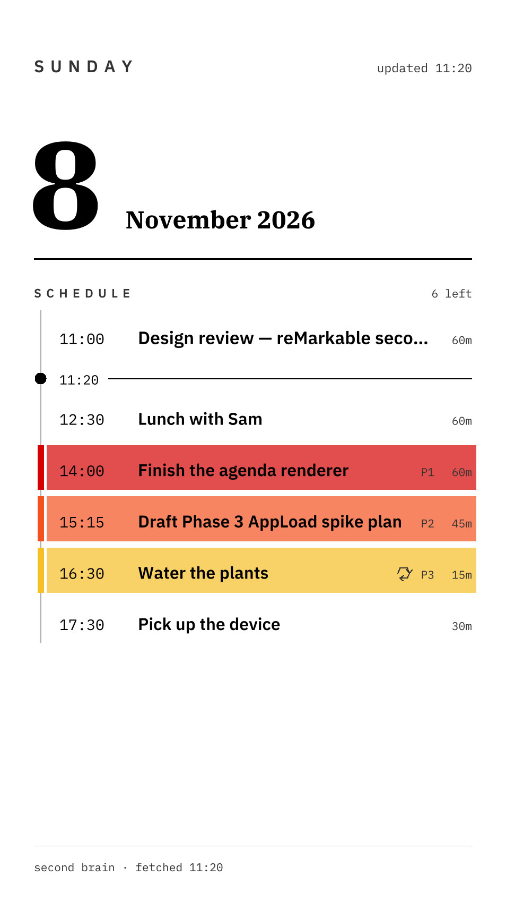
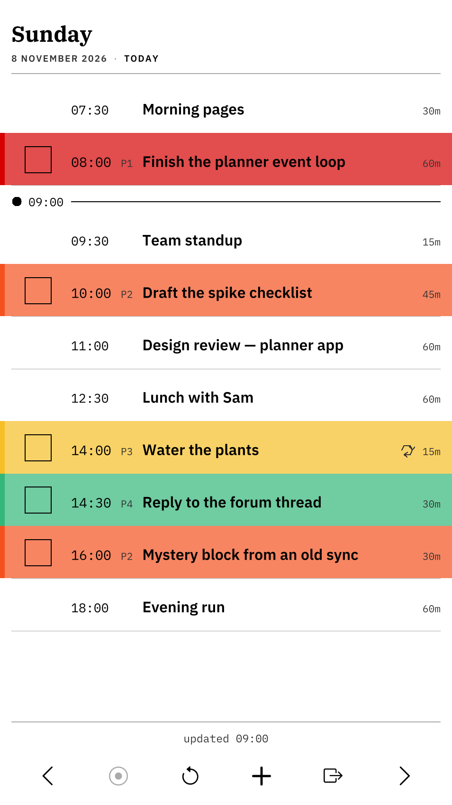
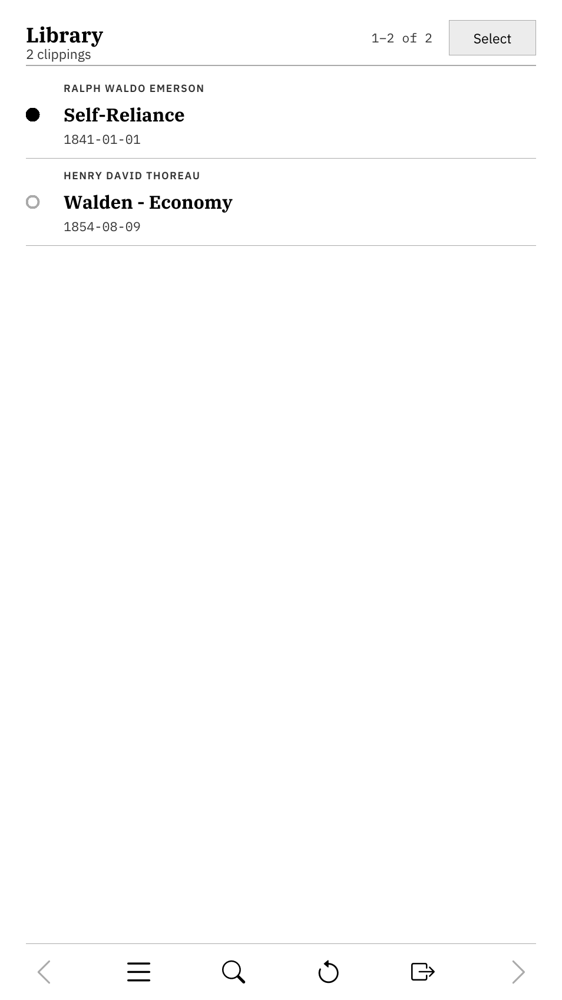
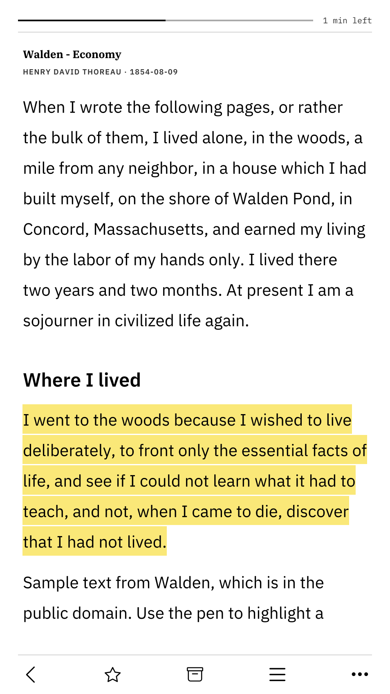

# remarkable-move-apps

Six apps and a lock-screen agenda for the reMarkable Paper Pro Move, written in Rust. They connect the tablet to Google Calendar, Todoist and an Obsidian vault synced with Git.

This is an unofficial project with no connection to reMarkable or Amazon. It needs developer mode and root access, and **turning on developer mode erases the tablet**. Read [SETUP.md](SETUP.md) before you start.

<p>
  
  
  
  
</p>

## What's included

| Part | What it does |
|---|---|
| Lock screen | Draws today's calendar and tasks as the suspend image, at 05:30, 12:30 and 18:30. |
| Agenda | Merges your calendars into one day view. You can check off, defer and add Todoist tasks, and changes made offline are queued. |
| Reader | Opens Markdown files from your vault. Pen highlights are saved as Obsidian `==highlight==` text and sync back through Git. Long-press a highlight to add a note or delete it. |
| Kindle Browser | Runs Amazon's Kindle Cloud Reader in an embedded WebKit browser, with pen highlighting and rotation buttons. You sign in with your own Amazon account. It doesn't remove DRM or export books. |
| One Thing | A focus timer that picks one Todoist task. |
| Habit and Recipe | A habit tracker and a recipe viewer that keep their files in the vault. |

## Requirements

- A reMarkable Paper Pro Move. It's the only model this has run on, and the layouts target its 954×1696 panel.
- OS 3.27.1.0, the only version tested. On 3.28.0.162, AppLoad 0.5.3 crashed the reMarkable interface into a reboot loop. AppLoad 0.6.0 has been released since then, and I haven't tried it.
- [XOVI](https://github.com/asivery/xovi) and [AppLoad](https://github.com/asivery/rm-appload).
- A computer with SSH and a USB-C cable.
- For the features you want: a Google service account (calendar), a Todoist API token (tasks), and a private Git repo (vault sync).

## Install

[SETUP.md](SETUP.md) has the full steps. Once developer mode and AppLoad are working, the install itself is:

```sh
curl -LO https://github.com/keithwithAI/remarkable-move-apps/releases/latest/download/secondbrain-device.tar.gz
tar xzf secondbrain-device.tar.gz
scp -r secondbrain root@10.11.99.1:/home/root/
ssh root@10.11.99.1 'sh /home/root/secondbrain/deploy/install.sh'
```

## Risks

- XOVI and AppLoad hook into the reMarkable interface. A version mismatch can stop it starting or make the tablet reboot repeatedly.
- The installer turns off automatic OS updates, because an OS update can break AppLoad and removes this project's system services. Re-run `install.sh` after any OS update you choose to install.
- Everything runs as root. If you turn on SSH over WiFi, root login is exposed to your local network.
- Self-update is off by default. It runs as root and checks downloads against a checksum file from the same release, and that file isn't signed. Turn it on only if you trust this repo's releases.
- The Kindle Browser uses WebKit 2.38.6, a fixed copy from 2023 that gets no security updates. It runs as root with WebKit's sandbox turned off, so a malicious web page could take over the tablet. The browser refuses to open anything except Amazon's own sites, which blocks links out to other websites, but it can't protect you from a problem on an Amazon page.
- Amazon can change Kindle Cloud Reader at any time, which may break the Kindle Browser. You're responsible for following Amazon's terms for your account.

Use this at your own risk. To go back to stock software, see [Removing everything](SETUP.md#removing-everything).

## Your credentials

Tokens and keys stay on your tablet in `/home/root/secondbrain/config/`, readable only by root. This repo contains none, and the `.gitignore` is set up to keep them out of your fork.

## Building from source

[secondbrain/README.md](secondbrain/README.md) covers tests, the desktop simulators, cross-compiling and releases. [ARCHITECTURE.md](ARCHITECTURE.md) explains how it fits together.

## Status

I'm selling my tablet, so I can't test changes on real hardware from here on. Issues and pull requests are welcome, but a fix that needs a device will depend on someone else testing it. Forks are encouraged.

## License

MIT, see [LICENSE](LICENSE). Fonts, ported code and the Kindle Browser's WebKit runtime have their own licenses, listed in [THIRD_PARTY_NOTICES.md](THIRD_PARTY_NOTICES.md).
